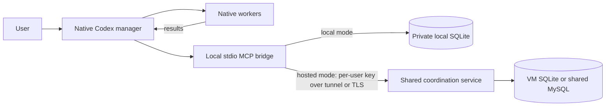

# Conductor


A portable shared task ledger and workflow for native Codex agents. For one coherent task, the primary agent works directly. For multiple distinct workstreams, it manages native workers, tracks dependencies and evidence, and reports verified results.

**Public preview.** This is a custom coordination integration, not an installation of the upstream project's terminal runtime. The service stores coordination metadata; Codex runs and supervises workers in its native client. It cannot spawn agents itself or keep a manager running after the client closes.

## Local macOS setup

For a single user on a Mac, run this from the checkout as your normal user:

```bash
bash install-macos.sh
```

Requires Python 3.11+ with `venv`/`pip` and internet access to install Python packages. The script creates a private virtual environment inside this checkout, installs a local SQLite MCP bridge, and verifies tool discovery and health. It adds the `conductor_coordination` connection to `~/.codex/config.toml` and the skill to `~/.agents/skills`, shared by Codex desktop and the Codex VS Code extension. Existing unrelated settings are preserved and an existing configuration is backed up before modification. No sudo, VM, Docker, SSH or service key is needed.

Keep this checkout in place. When active work is finished, restart Codex desktop and reload the VS Code window, then start new chats. Both clients must use the same Codex home; custom `CODEX_HOME` profiles need the same setting in each client. See [macOS setup details](docs/client-setup.md#local-macos-command-line-setup) for paths, reruns and verification limits.

## SSH command setup (recommended hosted path)

Conductor can run without MCP, a client Python runtime, copied service keys, or a continuously running application process. The VM stores task metadata in SQLite or an existing MySQL database. Codex desktop and the VS Code extension use the same installed skill and command in the user's shell. The command uses that user's existing SSH configuration, including keys, jump hosts and enterprise access tools. The VM authorizes the authenticated SSH login through `conductor-enroll` (or the configured enrollment group). Native Codex controls still spawn and supervise workers.

On the Linux VM, clone this repository and run `bash install-ssh-vm.sh`. For Salt-managed hosts, provide `/etc/conductor/conductor.yaml` and a pinned source bundle, then run `scripts/install_ssh_host.py` without prompts. The installer uses operating-system Python and YAML packages; MySQL additionally needs the operating-system PyMySQL package. It invokes no `pip` command and installs no MCP package. See [SSH command deployment](docs/ssh-command.md).

On Windows, follow the [one-file client setup](docs/ssh-client-quickstart.md): download only `install-ssh-client.ps1` from this repository and run it. Enter the VM SSH alias, hostname or IP. The installer verifies the login and ledger, then installs only a PowerShell command and Codex skill for this user. It creates no MCP configuration; when it recognizes a previous Conductor MCP installation, it backs up and removes that entry so the old tools no longer load. See [SSH command deployment](docs/ssh-command.md). Maintainers regenerate the script payload with `python3 scripts/build_windows_installer.py` after changing the client command or skill.

**The previous MCP installers below remain available for migration and existing installations.** Do not run them for the SSH command setup.

## Previous MCP setup

For one person on Windows, use the local-only graphical installer. The ledger runs inside the Codex MCP bridge on your computer and stores its SQLite data in a private local folder. No VM or continuously running service is needed. The [Windows setup guide](docs/windows-gui-setup.md) covers desktop and VS Code test profiles.

For one person on a Linux VM, clone or update this repository and run `bash install-vm.sh`. Its short setup asks whether to create a private SQLite ledger, import an existing Conductor SQLite ledger, or connect to an existing MySQL database. It writes `/etc/conductor/conductor.yaml`, installs the service under systemd, creates the first account and key, and verifies health. For a managed deployment, Salt supplies that YAML, a reviewed release bundle, database credentials and the service state without prompts. Multiple service nodes can use one MySQL database. See [host installation](docs/host-install.md). Codex and its native agents still run on each person's computer.

For an existing hosted VM using the previous MCP path, distribute the complete repository ZIP and run `connect-hosted.ps1` on each Windows client. It asks for the VM hostname/IP, uses the current Windows SSH identity, asks the VM to enroll that SSH login and privately transfers its Conductor key on first connection. It installs a private Python client runtime, verifies the service, and configures both Codex desktop and the Codex VS Code extension. The bridge opens and closes its own SSH tunnel as each client session runs; there is no permanent tunnel window. The VM administrator provisions SSH access and membership in the configured Conductor enrollment group. See [hosted client setup](docs/client-setup.md#single-script-windows-hosted-setup).

The Linux VM installer passed a fresh Ubuntu 24.04 service install, account checks and an unchanged rerun on a disposable guest. The updated Windows GUI has automated checks but still needs real desktop and VS Code acceptance before a stable release.

## Command-line guided setup (advanced)

Start the installer with **no arguments** from the checkout:

```bash
bash install.sh
```

On Windows, use Git Bash. From PowerShell the same entry point is one line:

```powershell
& "C:\Program Files\Git\bin\bash.exe" .\install.sh
```

The command-line wizard explains Conductor before asking installation questions. Choose **New installation** if you have never set up a service. You do not need a Conductor key or a token-file path to begin.

It guides you through:

1. What runs on the Linux service host versus your Codex computer.
2. Prerequisite checks and choosing this Linux computer or another Linux host over SSH.
3. Creating a separate service, generating its connection key and transferring it privately.
4. Verifying the service connection before configuring any Codex profile.
5. Preparing isolated desktop and/or VS Code profiles and verifying their actual MCP connections.
6. Opening supported isolated clients, signing in and running one short setup check.

Have Python 3.11+ and Bash available on the Codex computer. Windows uses Git Bash with native Windows Python. The service host needs Linux, Docker Engine/Compose and, for remote setup, an SSH login you control. The wizard checks these and explains missing requirements. It does not silently install operating-system packages, create a VM, or modify an existing service. Codex needs your own sign-in and working native worker tools; Conductor cannot add those controls.

**A Git-host token is not a Conductor connection key.** A Git-host credential is needed only if the source repository is private. The Conductor service generates a different key during setup; the wizard handles its private file without printing its contents. The connection-file question appears only when you deliberately choose to connect to an already-running service.

The guided path uses a separately named service and isolated client profiles. Existing Codex configuration and global skills are not selected. You can pause with `q`, resume the same setup, or start a separate fresh setup. No NAS, Salt server, private DNS or existing MCP hub is required. See the [first-time walkthrough](docs/guided-setup.md).

The wizard can prepare both clients. It can open an isolated VS Code window, but automatic isolated Codex desktop launch is not supported: use a separate OS test account/VM or explicitly add Conductor to your usual Codex profile and restart the app. Profiles are not the same as proven frontend/native-worker acceptance; run the [quick setup check](docs/acceptance.md#quick-setup-check) in each actual client.

Advanced scripted deployment remains available through `bash install.sh server` and `bash install.sh client --help`. Deliberately changing normal user configuration requires the advanced `--configure-user` option; it is not the guided default. Operations, backups and custom connection details remain in [service operations](docs/operations.md) and [client setup](docs/client-setup.md).

## How it works



The ledger records task briefs, dependencies, exact worker IDs, results and concise evidence. Manager leases and fencing epochs reject stale writers; operation IDs support safe retries after uncertain responses. Workspace reservations help avoid concurrent overlapping writers. Completion gates require independent completed review **or** test coverage and integration coverage for implementation work.

The manager assesses real worker evidence. Status records do not prove artifacts are correct, authenticate model identity or provide per-worker filesystem isolation. In hosted mode, each issued key belongs to one account; keys for the same account share its workload trust domain.

The compact [coordinator skill](skills/conductor-coordinator/SKILL.md) loads its detailed workflow only when delegated work or recovery needs it. It uses relative references and the configured MCP server name; no shared drive or environment-specific instruction server is involved.

## Contents

- `src/conductor_coordination/`: service, durable store, named forwarding tools and local bridge.
- `deploy/`, `Dockerfile`, `compose.yaml`: portable service setup and deployment.
- `install-vm.sh`, `conductor-users.sh`: one-command VM install and account/key administration.
- `install-host.sh`, `scripts/install_host.py`, `examples/salt/`: lower-level pinned host setup and Salt example.
- `gui/`: Windows graphical setup source and reproducible build inputs.
- `scripts/install_client.py`: client configuration and skill installation.
- `skills/conductor-coordinator/`: self-contained manager/direct-task workflow.
- `tests/`: backend, deployment and client checks.
- [Windows graphical setup](docs/windows-gui-setup.md), [client setup](docs/client-setup.md), and [acceptance](docs/acceptance.md): installation details and real-client checks.
- [Hosted accounts](docs/accounts.md) and [host installation](docs/host-install.md): shared service setup and private keys.
- [Service operations](docs/operations.md): credential export, backups, isolated restore and upgrades.

## Operations and limits

Keep live SQLite on local persistent storage, not SMB/NFS. Use a consistent SQLite backup and test an isolated restore; copying only the active main database file can miss WAL state. MySQL deployments use a dedicated schema, database-managed backups and a TLS or Unix-socket connection. Multiple Conductor nodes may share that database; a load balancer, the database's own HA and Salt orchestration remain administrator responsibilities. Hosted account keys separate workloads within one trusted service administrator's domain, not an independent multi-tenant security boundary.

For upgrades, save a consistent backup, install a reviewed revision, rebuild/restart the service and check health plus known workloads. Leases do not stop workers: reconcile native worker state before recovery or replacing any worker, especially after restoring old metadata.

Supported transport is authenticated HTTP through loopback/SSH forwarding or an HTTPS reverse proxy you administer. The application does not terminate TLS itself. It does not require model API keys or Codex credentials on the VM; workers need their own project access on their client computer.

Automated checks cover service and bridge behavior. A bounded native desktop-session smoke also passed with real workers, independent validation and cleanup through the candidate service; [recorded acceptance](docs/acceptance.md) gives its exact evidence and limits. Fresh installed-frontend acceptance in desktop and VS Code remains separate; installing the package alone does not establish frontend support, full upstream feature parity or unattended orchestration. This preview still needs those checks before a stable release.

## Public release checks

The repository runs a read-only public-material check on pushes and pull requests. Run `python3 scripts/check_public_tree.py` before preparing a release; it checks tracked files for common credentials, private addresses, personal paths and secret-file names. Run `python3 scripts/build_windows_installer.py --check` to verify that the one-file Windows installer matches its maintained source. These checks reduce accidental disclosure, but they do not replace review of Git history, release attachments or live deployment settings.

## Provenance and licensing

[Upstream Firstmate](https://github.com/kunchenguid/firstmate) contributed the small normalized status-transition policy and concepts for task briefs, supervision and recovery. Pinned source references are in [upstream-lock.json](upstream-lock.json), and its MIT notice is retained in [UPSTREAM_LICENSE.txt](UPSTREAM_LICENSE.txt).

The SQLite and MySQL stores, manager leases, HTTP/MCP service, bridge, packaging and Codex workflow are new integration code. This package does not clone or run the upstream project's terminal fleet, watchers, model dispatch or social/voice adapters.

Conductor integration code is licensed under [MIT](LICENSE). The upstream notice remains in [UPSTREAM_LICENSE.txt](UPSTREAM_LICENSE.txt) for the portions and concepts derived from Firstmate.
